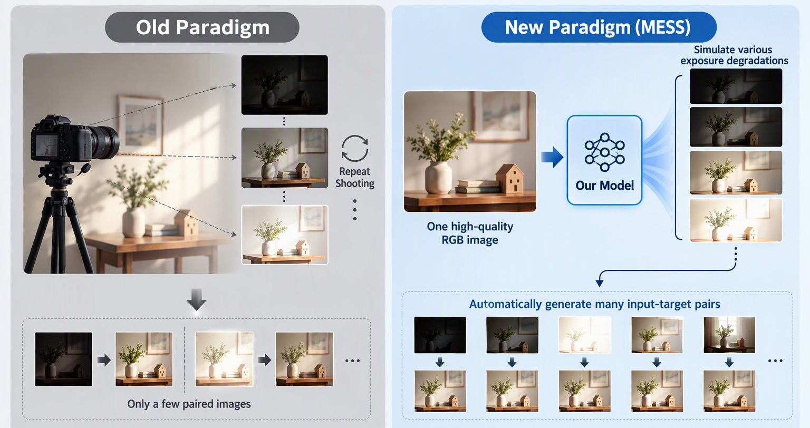

# MESS: Multi-Exposure Sequence Synthesis for Generalizable Image Enhancement

<p align="center">
  <a href="https://arxiv.org/abs/2610.24680"></a>
  <a href="https://huggingface.co/lahaina/MESS/tree/main"></a>
</p>

<p align="center">
  <a href="https://arxiv.org/search/cs?searchtype=author&query=Cui,+R">Ruodai Cui</a>,
  <a href="https://arxiv.org/search/cs?searchtype=author&query=Liu,+S">Shuaizheng Liu</a>,
  <a href="https://arxiv.org/search/cs?searchtype=author&query=Wu,+R">Rongyuan Wu</a>,
  <a href="https://arxiv.org/search/cs?searchtype=author&query=Zhang,+L">Lei Zhang</a>
</p>

<p align="center"><strong>Accepted at NeurIPS 2026</strong></p>

Official implementation of **MESS**, a diffusion-based RGB-to-MES framework that synthesizes realistic multi-exposure sequences from a single high-quality RGB image. MESS scales paired-data generation for generalizable low-light enhancement, exposure correction, and backlit image enhancement.

## Updates

- **2026-10-17:** [Paper](https://arxiv.org/abs/2610.24680) released on arXiv.
- **2026-10-17:** Pretrained model released on [Hugging Face](https://huggingface.co/lahaina/MESS/tree/main).

## Motivation

<p align="center">
  
</p>

Conventional paired-data collection requires repeatedly capturing the same static scene at different exposures. This process is expensive, difficult to scale, and restricts scene diversity. MESS replaces repeated capture with a learned RGB-to-MES generator: starting from one high-quality RGB image, it synthesizes exposure-controlled degradations and automatically forms many input-target pairs.

## Pretrained Weights

Download the released checkpoint from [lahaina/MESS on Hugging Face](https://huggingface.co/lahaina/MESS/tree/main).

Using Git LFS:

```bash
git lfs install
git clone https://huggingface.co/lahaina/MESS pretrained/MESS
```

Alternatively, download the checkpoint manually from the Hugging Face page. In the commands below, replace:

```text
pretrained/MESS/<checkpoint>.pkl
```

with the path to the downloaded `.pkl` checkpoint.

## Installation

### Option 1: Conda

```bash
conda env create -f environment.yaml
conda activate img2img-turbo
```

### Option 2: pip

```bash
conda create -n mess python=3.10 -y
conda activate mess
pip install -r requirements.txt
```

The first run also downloads the `stabilityai/sd-turbo` configuration and base components through Hugging Face. A CUDA-capable NVIDIA GPU is recommended. `xformers` is optional for inference but recommended for memory-efficient training.

## Quick Start: Inference

### 1. Prepare input images

Put images in one directory:

```text
inputs/
├── example_1.jpg
├── example_2.png
└── example_3.webp
```

Supported formats are JPG, JPEG, PNG, BMP, and WebP.

### 2. Run MESS

```bash
python src/inference.py \
  --model_path pretrained/MESS/<checkpoint>.pkl \
  --input_dir inputs \
  --output_dir results
```

The script creates a timestamped subdirectory under `results/`. For each input image, it generates seven exposure variants:

```text
example_1_ev00(-3).jpg
example_1_ev01(-2).jpg
example_1_ev02(-1).jpg
example_1_ev03(0).jpg
example_1_ev04(+1).jpg
example_1_ev05(+2).jpg
example_1_ev06(+3).jpg
```

Images are adjusted to dimensions divisible by 8 before inference, as required by the VAE and Haar-wavelet pipeline.

### Inference arguments

| Argument | Required | Description |
|---|---:|---|
| `--model_path` | Yes | Path to the released `.pkl` checkpoint |
| `--input_dir` | Yes | Directory containing input images |
| `--output_dir` | No | Output root; default: `result` |

## Training MESS

Training uses RAW-guided groups. Each scene contains style-varied renderings and camera-consistent exposure renderings of the same RAW image.

### Expected dataset layout

```text
<DATA_ROOT>/
└── <subset>/
    └── <scene>/
        ├── style/
        │   ├── mef_mertens.png
        │   ├── tm_reinhard.png
        │   └── ...
        └── exposure/
            ├── ev-3.png
            ├── ev-2.png
            ├── ev-1.png
            ├── ev+0.png
            ├── ev+1.png
            ├── ev+2.png
            └── ev+3.png
```

All renderings in one scene must be pixel-aligned. Both 8-bit and 16-bit images are supported. Exposure filenames may contain integer or decimal EV values, such as `ev+1.5.png`, `ev_-2.jpg`, or `-1.png`.

### 1. Build the JSONL manifest

```bash
python tools/build_mess_manifest.py \
  --data_root /path/to/MESS_RAW \
  --out /path/to/MESS_RAW/train.jsonl
```

Each JSONL record describes one RAW scene and its style/exposure renderings.

### 2. Train with the paper configuration

The provided launcher uses 8 GPUs, total batch size 64, random 512 x 512 crops, 200K iterations, AdamW, and cosine learning-rate decay from `1e-4` to `1e-6`:

```bash
DATA_ROOT=/path/to/MESS_RAW bash scripts/train_mess.sh
```

Equivalent direct command:

```bash
accelerate launch --multi_gpu --num_processes 8 src/train_mess.py \
  --train_manifest /path/to/MESS_RAW/train.jsonl \
  --output_dir output/mess \
  --crop_size 512 \
  --train_batch_size 8 \
  --total_batch_size 64 \
  --max_train_steps 200000 \
  --learning_rate 1e-4 \
  --min_learning_rate 1e-6 \
  --lambda_con 1.0 \
  --mixed_precision bf16 \
  --allow_tf32 \
  --enable_xformers_memory_efficient_attention \
  --gradient_checkpointing
```

### Single-GPU training or debugging

Gradient accumulation is derived from `--total_batch_size`:

```bash
python src/train_mess.py \
  --train_manifest /path/to/MESS_RAW/train.jsonl \
  --output_dir output/mess \
  --train_batch_size 2 \
  --total_batch_size 64 \
  --mixed_precision bf16 \
  --gradient_checkpointing
```

### Resume training

```bash
python src/train_mess.py \
  --train_manifest /path/to/MESS_RAW/train.jsonl \
  --output_dir output/mess \
  --resume output/mess/<run>/checkpoints
```

### Training outputs

```text
output/mess/<run>/
├── checkpoints/
│   ├── latest.pkl       # inference-compatible weights
│   └── train_state.pt   # optimizer, scheduler, and step
├── log/
│   └── loss.csv
└── viz/
    └── *.jpg
```

`latest.pkl` can be passed directly to `src/inference.py --model_path`.

## Repository Structure

```text
MESS/
├── MESS.jpg                         # motivation figure
├── README.md
├── environment.yaml
├── requirements.txt
├── scripts/
│   └── train_mess.sh                # paper-setting launcher
├── tools/
│   └── build_mess_manifest.py       # build training manifest
└── src/
    ├── inference.py                 # multi-EV inference
    ├── train_mess.py                # paper-aligned training
    ├── exposure_adjuster.py         # MESS network
    ├── wavelet_decomp.py            # Haar DWT/IDWT
    ├── model.py                     # SD-Turbo scheduler and VAE hooks
    └── my_utils/
        ├── mess_dataset.py           # RAW-guided triplet dataset
        └── training_utils.py         # legacy dataset utilities
```

## Citation

If you find this project useful, please cite:

```bibtex
@article{cui2026mess,
  title   = {{MESS}: Multi-Exposure Sequence Synthesis for Generalizable Image Enhancement},
  author  = {Cui, Ruodai and Liu, Shuaizheng and Wu, Rongyuan and Zhang, Lei},
  journal = {arXiv preprint arXiv:2610.24680},
  year    = {2026},
  doi     = {10.48550/arXiv.2610.24680}
}
```

## Acknowledgements

MESS builds on [SD-Turbo](https://huggingface.co/stabilityai/sd-turbo), PyTorch, Diffusers, Transformers, PEFT, and Accelerate.
